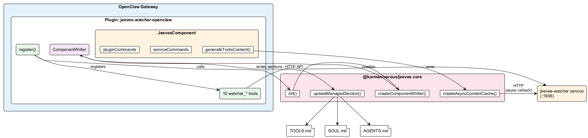

# OpenClaw Integration Guide

The `@karmaniverous/jeeves-watcher-openclaw` plugin gives your OpenClaw agent access to jeeves-watcher's semantic search, metadata enrichment, and management capabilities.

## Installation

The plugin is a standard OpenClaw plugin with no installer of its own. On a Jeeves box, `jeeves install` (from [`@karmaniverous/jeeves`](https://www.npmjs.com/package/@karmaniverous/jeeves) 0.6+) installs it and writes its config:

```bash
jeeves install watcher --config-root /srv/jeeves/config
```

Or install it directly with the OpenClaw CLI and set the config yourself:

```bash
openclaw plugins install npm:@karmaniverous/jeeves-watcher-openclaw@<version> --pin --accept-capabilities
```

The plugin registers an always-in-context rule set through OpenClaw's `before_prompt_build` hook, so it needs `plugins.entries.jeeves-watcher-openclaw.hooks.allowConversationAccess: true`. `jeeves install` / `jeeves update` grant this automatically (the hook is declared in `package.json` under `jeeves.conversationHooks`).

Restart the OpenClaw gateway to apply changes.

## Configuration

Plugin config lives in `openclaw.json` under `plugins.entries.jeeves-watcher-openclaw.config`:

```json
{
  "apiUrl": "http://127.0.0.1:1936",
  "apiKey": "<the service api.apiKey>",
  "configRoot": "/srv/jeeves/config"
}
```

- **`apiUrl`**: jeeves-watcher API base URL (default: `http://127.0.0.1:1936`; env fallback `JEEVES_WATCHER_URL`).
- **`apiKey`** (optional): bearer key sent as `Authorization: Bearer <key>` on every watcher API request; it must match the service's `api.apiKey`. Env fallback `JEEVES_WATCHER_API_KEY`. Resolved on every call and never logged. Unset (the default): no header is sent, exactly as before. If the service requires a key and it is missing or wrong, tools return an `HTTP 401 unauthorized` error naming both ways to set it (see [Errors](#errors)). Only `watcher_status` (`GET /status` is always open) and `watcher_service` (no HTTP) do not use it.
- **`configRoot`**: platform config root path, used by `@karmaniverous/jeeves` core to derive `{configRoot}/jeeves-watcher/`. **No default.** Set it in plugin config or via the `JEEVES_CONFIG_ROOT` env var.

`configRoot` is resolved lazily. The plugin always registers, even before its config is written (`openclaw plugins install` activates a plugin before `jeeves install` writes `plugins.entries.<id>.config`). While `configRoot` is unset the plugin logs one warning at registration. Gating is per call: only invocations that actually read `configRoot` are gated. Today that is exactly `watcher_service` with `action: "install"` (it derives the service config path from `configRoot`); it returns an error naming both ways to set it. Other `watcher_service` actions (`uninstall`, `start`, `stop`, `restart`, `status`) address the OS service by name, and every other tool only calls the watcher HTTP API, so they keep working without `configRoot`. Core is initialized on the first gated call after it resolves.

## Available Tools

The plugin registers 18 tools (`contracts.tools` in `openclaw.plugin.json`), all as optional tools. Core's toolset (`createPluginToolset` in `@karmaniverous/jeeves`) builds seven of them: `watcher_service`, plus six from the watcher's endpoint catalog (`WATCHER_CATALOG` in `@karmaniverous/jeeves-watcher-core`): `watcher_status`, `watcher_config`, `watcher_config_apply`, `watcher_search`, `watcher_scan` and `watcher_vcs_show`. Their parameters are generated from the catalog's request schemas, so they reject unknown parameters and carry the server's bounds. The other eleven are thin wrappers built by the plugin, one per watcher HTTP endpoint. Every HTTP tool reads `apiUrl` and the API key on each call and sends the key when one is configured (`watcher_status` never needs it).

### Errors

A non-2xx response from the watcher API becomes a tool error (prefixed `Error: `). The two kinds of tool report it differently:

- **Catalog-built tools** (`watcher_status`, `watcher_config`, `watcher_config_apply`, `watcher_search`, `watcher_scan`, `watcher_vcs_show`) report core's `HTTP <status>: <body>`, with the server's JSON body verbatim, e.g. `HTTP 400: {"code":"invalid_request","error":"Config validation failed","issues":[...]}`. A `401` is `HTTP 401: {"error":"Unauthorized","code":"unauthorized"}`; the skill's troubleshooting section says how to supply or fix the key. Parameters that fail the tool's own schema are rejected before any request is sent.
- **Plugin-built tools** report `HTTP <status> <code>: <message>`, where `<code>` is the server's machine-readable error code, e.g. `HTTP 400 invalid_request: Invalid filter`. A `401` keeps its key guidance: `HTTP 401 unauthorized: the watcher API requires an API key. Provide it via plugins.entries.jeeves-watcher-openclaw.config.apiKey or the JEEVES_WATCHER_API_KEY env var.` (or, when a key was sent, `... rejected the API key. Check ... against the service's api.apiKey.`). For these tools, structured `details` (Zod issues, per-property validation failures) stay in the HTTP response body. A refused, unresolvable or timed-out connection reads `Service not reachable at <apiUrl>.` with a hint to set `apiUrl`.

### `watcher_status`

Returns service health, uptime, and Qdrant collection statistics (`GET /status`, which never requires the API key). No parameters.

### `watcher_search`

Semantic search across all indexed documents (`POST /search`). Pass a natural-language query and optional filters. Returns `{ id, score, payload }` hits ordered by score; a source document's payload carries `source` and no `file_path`.

**Parameters:**

- `query` (string, required, non-empty) — search text
- `limit` (integer > 0) — max results (default: 10)
- `offset` (integer ≥ 0) — skip N results for pagination
- `filter` (object) — Qdrant filter conditions

Registered `catalogMode: 'direct-only'` (see the README's Tool Search section).

### `watcher_enrich`

Set or update metadata on a document by file path (`POST /metadata`). Metadata is validated against the schemas of the rules matching the file and merged into its points without re-embedding. Returns `{ ok: true, matched_rules }`. Source documents are enriched through `POST /metadata` with `source` directly; the tool sends `path` only.

**Parameters:**

- `path` (string, required) — file path of the document
- `metadata` (object, required) — key-value metadata to set on the document

### `watcher_config`

Query the effective runtime config via JSONPath (`GET /config`). Returns the full resolved merged document when no path is provided. Useful for discovering available inference rules, schemas, and runtime values. Only the allow-listed keys (`description`, `watch`, `configWatch`, `search`, `schemas`, `inferenceRules`, `mapHelpers`, `templateHelpers`, `maps`, `templates`) plus `issues` are included; `api`, `sources` and provider keys never are. Built by core's toolset from the catalog's `config` entry, with the API key.

**Parameters:**

- `path` (string, optional) — JSONPath expression

### `watcher_validate`

Validate a candidate config (or the current config if omitted), optionally testing file paths against it (`POST /config/validate`). Returns `{ valid: false, errors }`, or `{ valid: true, warnings?, testResults? }` with `{ path, matchedRules, metadata, error? }` per test path.

**Parameters:**

- `config` (object) — candidate config (partial or full); merged into the running config (top-level keys replace, `inferenceRules` merge by name). Omit to validate the current config.
- `testPaths` (string[]) — file paths to test against the config for a dry-run preview

### `watcher_config_apply`

Apply a config patch to the running watcher service (`POST /config/apply`, body `{ patch }`). The patch is deep-merged into the service's config file (`inferenceRules` by rule name), validated and written; the `configWatch.reindex` scope (default `issues`, files only) is then triggered. Built by core's toolset from the catalog's `configApply` entry, with the API key; the tool's `config` parameter is sent as `patch`.

**Parameters:**

- `config` (object, required) — config patch to apply
- `replace` (boolean) — replace the whole config with the patch instead of merging

Returns `{ applied: true, config }`. The echoed `config` is redacted through the same allow-list as `GET /config` (`api`, `sources` and provider keys are never echoed). When the config was written but the post-write apply step failed, the response also carries `warning` (a string). An invalid merged config is an `HTTP 400` whose body has `"error":"Config validation failed"` and the `issues`; use `watcher_validate` to see the individual errors. A server-side failure (config file unreadable or unwritable) comes back as a generic `internal_error`, with the cause in the service log.

### `watcher_reindex`

Trigger a scoped reindex (`POST /reindex`). Supports `rules`, `full`, `issues`, `path`, and `prune` scopes; the tool sends `rules` when `scope` is omitted (the HTTP API defaults to `issues`). Non-prune scopes return a blast area plan (files plus source documents). Live prune returns immediately without a plan. Explicit reindexes also cover source documents in `full`, `rules` (without `path`) and `issues`; `path` and `prune` cover files only (prune never deletes source points). Progress is reported by `watcher_status` under `health.reindex`. To reindex specific source references, call `POST /reindex` with `{ "scope": "path", "source": [...] }` directly; the tool has no `source` parameter.

**Parameters:**

- `scope` (string) — reindex scope (default: `rules`)
- `path` (string | string[]) — target file(s) or directories for `path` scope (required there); globs narrowing `rules` scope
- `dryRun` (boolean) — compute plan without executing

### `watcher_walk`

List watched files matching globs (`POST /walk`), from the filesystem watcher's in-memory file list across all configured watch roots, with `watch.ignored` and gitignore filtering applied. Returns `{ paths, matchedCount, scannedRoots }`; `HTTP 503 scan_in_progress` until the initial scan completes.

**Parameters:**

- `globs` (string[], required) — glob patterns to intersect with watch paths

### `watcher_scan`

Filter-only point query without vector search (`POST /scan`). Returns metadata for points matching a Qdrant filter. Use for structural queries: file enumeration, staleness checks, domain listing, counts.

**Parameters:**

- `filter` (object, required) — Qdrant filter object
- `limit` (integer, 1 to 1000) — page size (default: 100)
- `cursor` (string or number) — opaque cursor from previous response for pagination
- `fields` (string[]) — payload fields to return (projection)
- `countOnly` (boolean) — if true, return `{ count }` instead of points

### `watcher_issues`

List current processing issues (`GET /issues`): files and source documents with template or rule errors, or failed extraction, embedding, upsert, rule matching or source retrieval. Returns `{ count, issues }`, where `issues` maps each file path or source reference to its issue records (`type`, `message`, `timestamp`, and context fields). No parameters.

### `watcher_service`

Manage the watcher background service (install, uninstall, start, stop, restart, status). No HTTP call.

**Parameters:**

- `action` (string, required) — one of: `install`, `uninstall`, `start`, `stop`, `restart`, `status`

### Version Control (VCS) Tools

#### `watcher_vcs_status`

Get version tracking health: enabled state, tracked roots, remote status, last activity (`GET /vcs/status`). No parameters.

#### `watcher_vcs_history`

Query change history by path or glob with optional date range (`GET /vcs/history`).

**Parameters:**

- `glob` (string, required) — path or glob pattern to query history for
- `since` (string) — start date (ISO 8601 or git date string)
- `until` (string) — end date (ISO 8601 or git date string)
- `limit` (number) — maximum number of history entries to return

#### `watcher_vcs_show`

Retrieve file content at a specific version (`GET /vcs/show`). Returns the file's text, whatever its type (before the catalog slice the tool failed on any file that was not JSON). Built by core's toolset from the catalog's `vcsShow` entry.

**Parameters:**

- `path` (string, required, non-empty) — file path to retrieve
- `commit` (string, required, non-empty) — version identifier

#### `watcher_vcs_diff`

Show what changed between two versions, or between a version and current (`GET /vcs/diff`).

**Parameters:**

- `glob` (string, required) — path or glob pattern to diff
- `commit` (string, required) — start version identifier
- `commitEnd` (string) — end version identifier (defaults to current if omitted)

#### `watcher_vcs_revert`

Undo changes by restoring files to a specific version (`POST /vcs/revert`).

**Parameters:**

- `glob` (string, required) — path or glob pattern to revert
- `commit` (string, required) — version to restore files to
- `existingOnly` (boolean) — when true, only revert files that currently exist (skip deleted files)

#### `watcher_vcs_exclude`

Exclude or re-include paths from version tracking (`POST /vcs/exclude`).

**Parameters:**

- `glob` (string, required) — glob pattern to exclude or re-include
- `root` (string) — tracked root to target (defaults to auto-detect)
- `remove` (boolean) — when true, remove the exclusion rule (re-include the path)

#### `watcher_vcs_check`

Check whether a path is excluded from version tracking and why (`GET /vcs/check-exclusion`).

**Parameters:**

- `path` (string, required) — file path to check exclusion status for

## Architecture



## Jeeves Platform Integration

The plugin builds on [`@karmaniverous/jeeves`](https://www.npmjs.com/package/@karmaniverous/jeeves) 0.7 (static-content core since 0.6). It writes **no** workspace files and starts no timers:

- **Always-in-context rules**: the watcher escalation, scan-first and search-first rules and score guidance are injected on every turn via `before_prompt_build` (`registerPromptContext`). They replace the v0.x TOOLS.md `## Watcher` section.
- **Live state**: served by tools (`watcher_status`, `watcher_config`) rather than a refreshed file.
- **Skill**: `jeeves-watcher` ships in the package and is declared in `openclaw.plugin.json` (`skills`).
- **Static platform content** (SOUL.md / AGENTS.md blocks) is rendered only by `jeeves install`.

## Example Usage Patterns

### Search for relevant documents

> "Search the watcher for documents about authentication configuration"

The agent calls `watcher_search` with the query and returns matching document chunks with their source paths and metadata.

### Check service health

> "Is the watcher service running? How many documents are indexed?"

The agent calls `watcher_status` and reports uptime, health, and collection point count.

### Investigate indexing problems

> "Are there any files that failed to index?"

The agent calls `watcher_issues` and summarizes any errors or warnings.

### Reindex after config change

> "I updated the watcher config — please reindex everything"

The agent calls `watcher_config_apply` (if a new config is provided), then `watcher_reindex` with `scope: "full"`, previewing the blast area with `dryRun: true` first.
