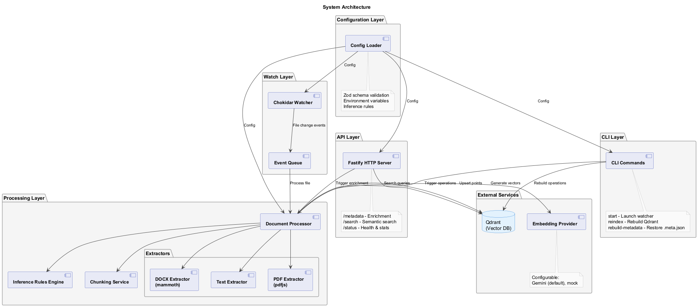
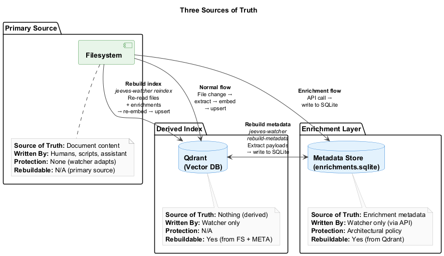
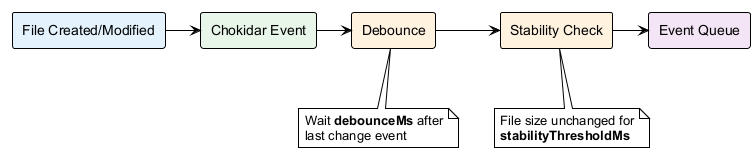
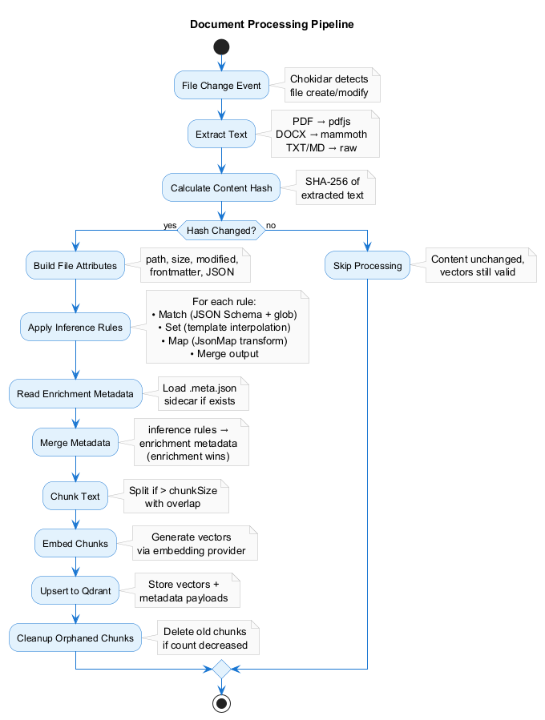
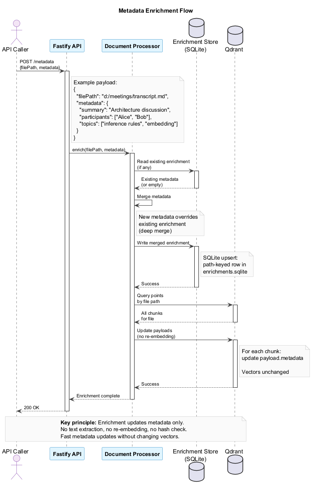
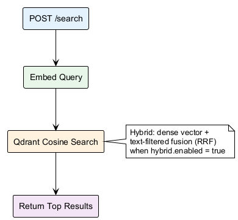
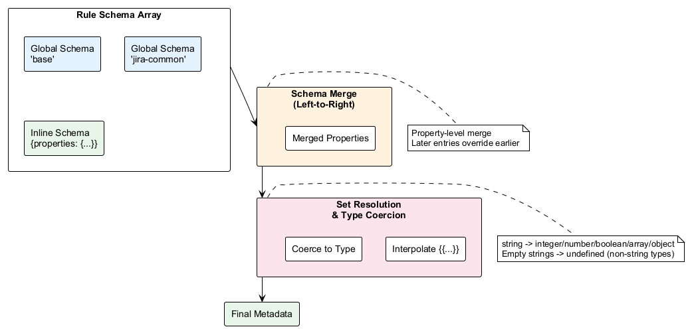
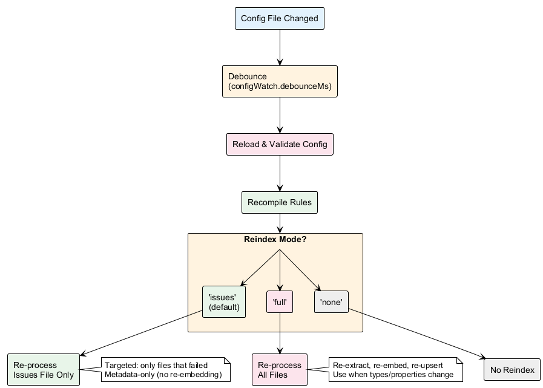

# Architecture

High-level architectural overview of `jeeves-watcher` for contributors and advanced users.

## Design Principles

1. **Files are just files** — Processes write to the filesystem normally. The watcher discovers changes passively.
2. **Config-driven, no domain logic** — The watcher doesn't know what an "email" or "meeting" is. Domain semantics live in config (inference rules).
3. **Embedding is swappable** — Embedding providers are selected by `embedding.provider`; adding a provider is a small, self-contained code change (see [Add a New Embedding Provider](#add-a-new-embedding-provider)).
4. **Metadata enrichment is optional** — The watcher works without it, but callers can enrich documents for better search quality.
5. **Three sources of truth** — Filesystem owns content, the enrichment store owns enrichment, Qdrant is a derived index (fully rebuildable).

---

## System Architecture



The watcher consists of several layered components:

- **Configuration Layer** — Zod-validated config with environment variable substitution
- **Watch Layer** — Chokidar filesystem watcher feeding the file event queue; source-document notifications feed a separate notify queue
- **Processing Layer** — Document processor: resolvers (file and source), extractors, inference rules engine, and one shared chunk/embed/upsert pipeline
- **State** — Enrichment store, issues file and values index under `stateDir` (default `.jeeves-metadata`)
- **External Services** — Configurable embedding provider (behind one shared rate limiter) + Qdrant vector store
- **API Layer** — Fastify HTTP server for search, enrichment, reindex, source notifications and administration
- **CLI Layer** — Command-line interface for operations

---

## Three Sources of Truth



The system maintains three distinct stores:

- **Filesystem** (watched directories) — Primary source of document content
- **Enrichment store** (`<stateDir>/enrichments.sqlite`, `node:sqlite`) — Enrichment metadata added via API
- **Qdrant** (vector database) — Derived index, fully rebuildable

### Rebuild Flows

**Qdrant lost → Rebuild from filesystem + enrichment store:**

```bash
jeeves-watcher reindex --scope full
```

Re-extracts every watched file, merges its enrichment from the enrichment store, re-embeds the content and upserts to Qdrant. (The CLI's default scope is `rules`, which only re-applies rules to points that already exist.)

**Enrichment store lost → Rebuild from Qdrant:**

```bash
jeeves-watcher rebuild-metadata
```

Scrolls Qdrant and, for every file point, writes its payload minus the reserved system fields (identity, chunk, hash, date, line and `matched_rules` fields) to the enrichment store. Rule-derived fields are therefore written too; source documents are not rebuilt.

---

## Data Flow

### 1. File Change Event



**Debounce:** Events for the same path are collapsed until `watch.debounceMs` (default: 300 ms) has passed since the last one (prevents re-embedding during rapid edits).

**Stability Check:** Chokidar's `awaitWriteFinish` holds an event until the file size has been unchanged for `watch.stabilityThresholdMs` (default: 500 ms; prevents embedding partial writes).

### 2. Document Processing Pipeline



The core processing flow transforms file changes into searchable vectors. The file resolver (steps 1–4) produces a document; the shared pipeline (steps 5–12) indexes it. Source documents use the source resolver and the same pipeline.

1. **Extract Text** — Format-specific extraction (PDF, DOCX, Markdown, etc.)
2. **Build Attributes** — Collect file attributes (path, size, modified, frontmatter, JSON)
3. **Apply Inference Rules** — Match → Schema Merge → Type Coercion → Map → Merge (see [Inference Rules](inference-rules.md))
   - Match rules against file attributes (JSON Schema validation)
   - Merge schema references (global schemas + inline) left-to-right
   - Resolve `set` templates and coerce to declared types
   - Apply JsonMap transformations (if present)
   - Track matched rule names in `matched_rules`
4. **Merge Enrichment** — Read the document's entry from the enrichment store and merge it over the rule metadata (scalars: enrichment wins; arrays: union, deduplicated)
5. **Update Values Index** — Record distinct values per property per matched rule (runs even when the content turns out unchanged)
6. **Empty Check** — Whitespace-only text is skipped (logged at `debug` as `Skipping empty document`)
7. **Content Hash** — SHA-256 of the text to embed (a matching rule's rendered template output, otherwise the extracted text)
8. **Hash Check** — If chunk 0 already carries the same `content_hash`, the file is skipped: nothing is embedded or written
9. **Chunk Text** — Split large documents with overlap
10. **Embed Chunks** — Generate vectors via the embedding provider (up to 100 chunks per request)
11. **Upsert to Qdrant** — Store vectors + payloads (including `matched_rules`), 50 points per request
12. **Cleanup Orphaned Chunks** — Remove old chunks if the document shrank

### 3. Metadata Enrichment (API)



The enrichment API allows external callers to add metadata without re-embedding:

1. **POST /metadata** with a file `path` (or a source reference `source`) and `metadata`; values that do not match the matching rules' declared property types are rejected with `400 invalid_request`
2. **Store** — The metadata is merged into the document's entry in the enrichment store (top-level keys replace existing ones). For a file, the entry is stored even when the file is not indexed yet, so it applies once it is
3. **Update Qdrant payloads** — If the document is indexed, the stored enrichment is written to the payload of every chunk (reserved system fields are dropped; the stored identity and `matched_rules` are kept)

**Key principle:** Enrichment updates metadata only. No text extraction, no re-embedding, no hash check. Fast metadata updates without changing vectors.

### 4. Search Flow



**Chunk deduplication:** Search returns individual chunks. Callers group by `file_path` (or `source`) to get unique documents.

---

## Chunking Strategy

Documents exceeding `embedding.chunkSize` (default: 1000 characters) are split into chunks.

**Splitters:**

- **Markdown files** (`.md`, `.markdown`) — `MarkdownTextSplitter` (splits on heading boundaries, preserves structure)
- **All other files** — `RecursiveCharacterTextSplitter` (splits on `\n\n`, then `\n`, then spaces, then characters)

Both splitters use:

- `chunkSize` — max characters per chunk
- `chunkOverlap` — overlap between consecutive chunks (default: 200; helps preserve context at boundaries)

**Chunk Points:**

Each chunk becomes a separate Qdrant point with:

- **Unique ID:** `pointId(filePath, chunkIndex)` (deterministic UUID)
- **Shared payload:** `file_path`, `matched_rules`, rule and enrichment metadata, `content_hash`, `created_at`, `modified_at` (same across all chunks)
- **Chunk-specific:** `chunk_index`, `total_chunks`, `chunk_text`, `line_start`, `line_end`

**Example:**

File with 3 chunks → 3 Qdrant points:

| Point ID | `chunk_index` | `total_chunks` | `chunk_text`      |
| -------- | ------------- | -------------- | ----------------- |
| `uuid-0` | `0`           | `3`            | "First chunk..."  |
| `uuid-1` | `1`           | `3`            | "Second chunk..." |
| `uuid-2` | `2`           | `3`            | "Third chunk..."  |

---

## v0.5.0 Processing Details

### Schema Merge Flow

The v0.5.0 inference rules system uses declarative JSON Schemas with type coercion. When a rule matches a file, the watcher merges schema references and applies type coercion:



**Key steps:**

1. **Resolve named references** from global `schemas` collection
2. **Merge properties** left-to-right (later entries override earlier ones)
3. **Validate completeness** — every property must have a `type`
4. **Resolve `set` templates** — interpolate `{{...}}` Handlebars expressions against file attributes
5. **Coerce values** — convert strings to declared types (integer, number, boolean, array, object)
6. **Omit failures** — properties that fail coercion are excluded from payload

### Config Watch Reindex Flow

When the config file changes, the watcher triggers a reindex whose scope is set by `configWatch.reindex`:



**Scopes:**

- **`issues`** (default) — Re-process only the files and source references listed in the issues file (cheap, targeted)
- **`rules`** — Re-apply the rules to indexed files without re-embedding
- **`full`** — Re-process all watched files and indexed source documents (expensive, comprehensive)

To turn automatic reloads off, set `configWatch.enabled` to `false` (then use `POST /reindex` manually).

---

## Content Hashing

Every processed document gets a content hash (`sha256` of the text to embed) stored in the Qdrant payload.

**Whenever a file is processed** (initial scan, create, modify, `issues`/`path`/`full` reindex):

1. Extract text and apply rules
2. Compute hash
3. Read the existing chunk-0 point from Qdrant
4. If `content_hash` matches → **skip** (no embedding API call, no write)
5. If the hash differs or the point is missing → re-embed and upsert

**Benefits:**

- Saves embedding API calls when the embedded text is unchanged (e.g. a file touched or rewritten with the same content)
- Prevents unnecessary Qdrant writes
- Speeds up reindex (only changed files are re-embedded)

**Note:** A skipped file is not rewritten at all, so an edit that leaves the embedded text unchanged (such as a Markdown frontmatter-only edit) does not refresh rule metadata on its points. Run a `rules` reindex to re-apply rules without re-embedding.

---

## Point ID Generation

Qdrant point IDs are **deterministic UUIDs** derived from the document's identity (see `src/pointId/index.ts`):

```typescript
import { v5 as uuidV5 } from 'uuid';

const NAMESPACE = '6a6f686e-6761-4c74-ad6a-656576657321'; // fixed

// Files: the path is normalised, so file IDs are case-insensitive.
function pointId(filePath: string, chunkIndex: number): string {
  return uuidV5(`${normalizePath(filePath)}#${chunkIndex}`, NAMESPACE);
}

// Source documents (v0.20.0+): the exact <name>://<id> reference, not normalised.
function sourcePointId(reference: string, chunkIndex: number): string {
  return uuidV5(`${reference}#${chunkIndex}`, NAMESPACE);
}
```

**Why deterministic:**

- Same file always produces the same ID
- No need to store ID anywhere — it's computable from the path
- A move gets new IDs: the old points are re-written under the new path's IDs (vectors reused, no re-embed) and then deleted

**Trade-off:** Renaming/moving files changes their identity in the index. Acceptable — the watcher handles it transparently (with `watch.moveDetection`, an unlink followed by an add of the same content is treated as a move).

---

## Event Processing

### File Event Queue

Filesystem events go through one debounced, concurrent queue.

**Debounce:** Events for one path (and priority) are collapsed: only the last event within `watch.debounceMs` (default: 300 ms) is processed.

**Concurrency:** Up to `embedding.concurrency` (default: 5) documents are processed at once; normal-priority events run before low-priority ones. Embedding API requests from every path (watch, source-document notifications, reindex, search) draw from one shared rate limiter (`embedding.rateLimitPerMinute`, counted in requests since v0.20.0).

**Failures:** A failing document is logged and recorded in the issues file; it does not stop the queue.

### Source Notify Queue

Source-document notifications (v0.20.0+) go through a separate in-memory queue keyed by reference, with the same `embedding.concurrency`. Pending notifications for one reference merge; a notification for a reference that is already running marks it for exactly one re-run.

### Resolvers

Both queues end in the document processor. A **file resolver** stats and extracts the file and applies every matching rule; a **source resolver** retrieves the `<name>://<id>` reference through its callback and applies only the designated rule. Each produces a resolved document for the same chunk/embed/upsert pipeline. Source rules get no file reader: a map's `fetchSiblings` returns nothing for a source document.

### Startup Behavior

On service start:

1. Load and validate the config; reserved-field warnings are printed to the console
2. Create the Qdrant collection if missing and ensure its payload indexes
3. Open the enrichment store, issues file and values index under `stateDir`
4. Start the API server, then the filesystem watcher and the source notify queue
5. Initial scan: every file matching `watch.paths` (and not ignored or gitignored) is queued as a create event
6. Each queued file runs through the pipeline: unchanged files are skipped by content hash, new and modified files are embedded

Points of files deleted while the service was down are **not** removed at startup; run a `prune` reindex (`jeeves-watcher reindex --scope prune`) to delete them.

### Config Change Handling

When `configWatch.enabled` is `true` (the default) and the service was started with a config path, the watcher monitors its own config file.

**On config change:**

1. Debounce for `configWatch.debounceMs` (default: 1000 ms)
2. Reload and validate the config; reserved-field warnings are logged as warnings
3. Recompile inference rules and rebuild the template engine
4. Rebuild the filesystem watcher if the `watch` config changed
5. Run a reindex with scope `configWatch.reindex` (default: `issues`)

A reload that fails is logged (`Failed to reload config`) and the previous config stays in effect. `api.apiKey`, `sources` and `vectorStore.payloadIndexes` are read at startup only.

---

## Enrichment Store Design

### Storage

Enrichment lives in a SQLite database at `<stateDir>/enrichments.sqlite`, opened with Node's built-in `node:sqlite` (WAL journal, 5 s busy timeout). One table holds one row per document:

| Column       | Content                                          |
| ------------ | ------------------------------------------------ |
| `path`       | Document key (primary key)                       |
| `metadata`   | Enrichment metadata as JSON (no content/vectors) |
| `created_at` | ISO timestamp of the first write                 |
| `updated_at` | ISO timestamp of the last write                  |

**Keys:** File paths are normalised (lowercase, forward slashes), so lookups are case-insensitive; source references (`<name>://<id>`) are stored verbatim.

**Merge on write:** A new write merges into the existing entry; top-level keys of the new metadata replace existing ones.

### Write Policy

The enrichment store is **watcher-owned**. Only the watcher process writes to it: `POST /metadata`, `POST /rebuild-metadata`, file moves (the entry follows the file) and file deletes (the entry is removed).

**Enforcement:** Architectural policy (single writer; no filesystem permissions).

---

## Inference Rules Engine

Rules are **JSON Schema `match` + `schema` arrays**, evaluated in order against file attributes.

**Attributes:**

```json
{
  "file": {
    "path": "d:/meetings/2026-02-20/transcript.md",
    "directory": "d:/meetings/2026-02-20",
    "filename": "transcript.md",
    "extension": ".md",
    "sizeBytes": 4523,
    "modified": "2026-02-20T08:15:00.000Z"
  },
  "frontmatter": { "title": "Meeting Notes", "author": "jeeves" },
  "json": { "participants": ["Alice", "Bob"] }
}
```

**Rule example (v2):**

```json
{
  "name": "meetings-classifier",
  "description": "Classify meeting transcripts and notes",
  "match": {
    "properties": {
      "file": {
        "properties": {
          "path": { "type": "string", "glob": "d:/meetings/**" }
        }
      }
    }
  },
  "schema": [
    "base",
    {
      "properties": {
        "domain": { "type": "string", "set": "meetings" },
        "title": { "type": "string", "set": "{{frontmatter.title}}" }
      }
    }
  ],
  "map": "extractProject"
}
```

**Processing order for each matching rule:**

1. **`match`** — JSON Schema validation against file attributes
2. **Schema merge** — Resolve named schemas + inline objects, merge left-to-right
3. **`set` resolution** — Handlebars template interpolation (`{{...}}`) resolves against attributes, with type coercion
4. **`map`** — JsonMap transformation (inline or named reference)
5. **Merge** — `map` output overrides `set` output on field conflict

**Custom `glob` keyword:** Picomatch glob matching registered as an ajv custom keyword. Everything else is standard JSON Schema (with the standard `ajv-formats` formats).

**JsonMap transformations (`map`):**

Rules can reference named maps from the top-level `maps` config, or include inline JsonMap definitions. The watcher provides lib functions for path manipulation and lookups: `split`, `slice`, `join`, `toLowerCase`, `replace`, `get`, `lookupJson`, `mapLookup`, `fetchSiblings`; custom functions can be added via `mapHelpers`.

See [Inference Rules Guide](./inference-rules.md) for full details.

---

## Text Extraction

### Extractors by File Type

| Extension | Strategy |
| --- | --- |
| `.md`, `.markdown` | Parse YAML frontmatter (exposed as `frontmatter` attributes), return the body text |
| `.txt`, `.text` | Return as-is (BOM stripped) |
| `.json` | Return the first non-empty string among `content`, `body`, `text`, `snippet`, `subject`, `description`, `summary`, `transcript`; otherwise the serialized JSON. A JSON object is also exposed as `json` attributes |
| `.pdf` | Extract text via the `unpdf` library (pages joined) |
| `.docx` | Extract raw text via the `mammoth` library |
| `.html`, `.htm` | Drop `script`/`style`, take the body text via the `cheerio` library |

**Any other extension** is read as plain text. Use `watch.paths` globs (or `watch.ignored`) to keep binary files such as `.png` out of the index. A file whose extracted text is empty or whitespace-only is skipped.

---

## Error Handling & Retry

Transient failures are retried; anything that still fails is recorded as an issue:

| Failure | Retry Policy |
| --- | --- |
| Embedding provider 429 (rate limit) | Every caller pauses on the shared limiter. A `Retry-After` up to `maxBackoffMs` (default 60 s) is honoured; a longer one fails fast. Without `Retry-After`: backoff from 1 s, doubling, capped at `maxBackoffMs`. Up to 5 provider calls per embed (3 for a search query) |
| Embedding provider network error or other non-2xx | 5 attempts, exponential backoff from 500 ms capped at 10 s (+ up to 20% jitter); each retry draws from the shared limiter |
| Qdrant write (upsert, delete, set-payload, delete-payload) | 5 attempts, same backoff, each retry on a fresh Qdrant client |
| Text extraction error | No retry (logged and recorded as an `extraction_error` issue) |

**Issues file:** Documents that fail are recorded in the issues file (persisted to `{stateDir}/issues.json`) with a canonical issue code (`embedding_error`, `upsert_error`, `extraction_error`, ...). Surfaced via `GET /issues`; re-processed by an `issues` reindex (the default on config reload).

---

## Graceful Shutdown

On SIGTERM/SIGINT (v0.20.0+ order):

1. Stop the config watcher
2. Close the API server, so no new request (notification, reindex, ...) is accepted
3. Stop the remaining producers: VCS, then the filesystem watcher
4. Drain and stop the file event queue, then drain and stop the source notify queue (each drain and each stop bounded by `shutdownTimeoutMs`, default 10 s); stopping drops work the drain did not reach and waits for in-flight runs
5. Flush the values index
6. Close the enrichment store, unless a queue step timed out (runs may still be in flight; the store is then left open and a warning is logged)
7. Exit

Partially processed files are safe — on the next start the initial scan re-processes every file, and content hashing skips the ones already indexed.

---

## Collection Bootstrap

On startup, if the Qdrant collection doesn't exist, the watcher creates it, then creates any missing payload indexes (configured `vectorStore.payloadIndexes` plus the system `source`/`source_rule` indexes):

```javascript
await qdrant.createCollection(collectionName, {
  vectors: {
    size: dimensions, // embedding.dimensions (Gemini default: 3072)
    distance: 'Cosine',
  },
});
```

**Existing collections:** If the collection already exists, it is used as-is — dimensions and distance metric are not validated against config on startup.

**Dimension mismatch warning:** If you manually create the collection with different dimensions (e.g., 768 instead of 3072), the service will start but embedding upserts will fail with a dimension mismatch error.

**Recovery:** Delete the collection manually (or rename `collectionName` in config), then restart. The watcher will recreate the collection with correct dimensions.

---

## Logging

Structured JSON logging via [pino](https://github.com/pinojs/pino), at `logging.level` (default `info`):

| Level | Events (log message) |
| --- | --- |
| `info` | `File processed successfully`, `File deleted from index`, `File moved in index`, `Metadata updated`, `Config reloaded`, `Initial scan complete`, `Reindex (<scope>) completed`, `jeeves-watcher started` / `stopped` |
| `warn` | `Embedding call failed; will retry`, `Qdrant <operation> failed; will retry`, shutdown step timeouts, reserved-field warnings on reload |
| `error` | `Failed to process file` (after retries; issue recorded), `Failed to reload config`, `Reindex failed`, `Watcher error` |
| `debug` | `Content unchanged, skipping`, `Skipping empty document`, `File added` / `File changed` / `File removed`, `Skipping gitignored file` |

**Log format:** JSON lines on stdout, or to `logging.file` when set (parseable by standard log aggregators).

---

## Technology Choices

| Component | Library | Rationale |
| --- | --- | --- |
| Filesystem watcher | `chokidar` | Cross-platform, battle-tested (globs are matched with `picomatch`) |
| HTTP framework | `fastify` | Lightweight, fast |
| Request validation | `zod` | Shared request/response schemas in the core package |
| Text splitting | `@langchain/textsplitters` | Markdown-aware + recursive splitting |
| JSON Schema validation | `ajv` | Fast, extensible (custom `glob` keyword) |
| Embedding client | Direct HTTPS (`node:https`, Gemini REST API) | No SDK bloat |
| Qdrant client | `@qdrant/js-client-rest` | Official client, typed |
| Enrichment store | `node:sqlite` | Built into Node.js, no native build |
| Logging | `pino` | Structured JSON, low overhead |

---

## Extending the Watcher

### Add a New Extractor

Extractors are registered in code, not in config. Implement an extractor and add it to `extractorRegistry` in `src/extractors/index.ts`:

```typescript
async function extractYaml(filePath: string): Promise<ExtractedText> {
  const content = await readFile(filePath, 'utf8');
  const parsed = yamlLoad(content) as Record<string, unknown>;
  return {
    text: JSON.stringify(parsed, null, 2),
    json: parsed,
  };
}

const extractorRegistry = new Map<string, Extractor>([
  // ...existing entries
  ['.yaml', extractYaml],
]);
```

### Add a New Embedding Provider

1. Implement a provider factory (see `src/embedding/types.ts`):

```typescript
const createMyProvider: ProviderFactory = (config, logger) => ({
  dimensions: config.dimensions ?? 1024,
  async embed(texts: string[]): Promise<number[][]> {
    // Call your provider's API (one request per call)
  },
});
```

2. Register it in `embeddingProviderRegistry` in `src/embedding/index.ts`:

```typescript
const embeddingProviderRegistry = new Map<string, ProviderFactory>([
  ['mock', createMockFromConfig],
  ['gemini', createGeminiProvider],
  ['my-provider', createMyProvider],
]);
```

3. Use in config:

```json
{
  "embedding": {
    "provider": "my-provider",
    "model": "my-model",
    "apiKey": "${MY_API_KEY}"
  }
}
```

---

## Version Control Subsystem

The VCS subsystem runs alongside the embedding pipeline as an independent data flow. Both systems share watch paths but maintain separate state.

### VCS Data Flow

1. **File change event** → routed to both the embedding pipeline and VCS coordinator
2. **VCS coordinator** → maps the file to the correct watch root's `VcsManager`
3. **VcsManager** → adds file to pending set, resets debounce timer
4. **Debounce expires or batch full** → `commitBatch()` stages files, generates commit message, commits
5. **If remote configured** → pushes to remote (non-blocking)
6. **Squash scheduler** (cron) → periodically squashes old commits per retention rules

### Key Design Decisions

- **D1:** VCS is opt-in (`vcs.enabled: false` by default)
- **D2:** One git repo per watch root — isolated histories
- **D3:** VCS and watcher indexing are independent — git can track files the watcher cannot embed and vice versa
- **D4:** Child repos tracked uniformly; child `.git/` directories excluded
- **D5:** Debounced batch commits prevent per-file commit noise
- **D6:** AI commit messages via the Anthropic API (key from `vcs.commitMessage.apiKey`, else from the local OpenClaw config); template message fallback
- **D7:** Squash retention with `maxAgeDays` / `maxVersions` (tighter wins)
- **D8:** Forward-only reversion — `git show` + write, HEAD never moves backward
- **D9:** Optional remote push per root with access token auth
- **D12:** Per-root config overrides via `watch.paths` object entries
- **D13:** Force push after squash — acceptable because remote is a backup mirror
- **D14:** Git is a soft dependency — graceful degradation if not installed
- **D15:** `stateDir` must not overlap watch paths — validated at startup when VCS is enabled

### Concurrency

Each `VcsManager` serializes commits within its root (single commit in-flight). The `index.lock` retry mechanism (4 attempts, exponential backoff) handles contention with external git processes. Squash operations that encounter a held lock abort cleanly and retry on the next cron cycle.

See the [Version Control (VCS) Guide](./version-control.md) for full operational details.

---

## Next Steps

- [Configuration Reference](./configuration.md) — All config options
- [Inference Rules Guide](./inference-rules.md) — Rules engine deep dive
- [API Reference](./api-reference.md) — HTTP endpoints
- [Deployment Guide](./deployment.md) — Production setup
