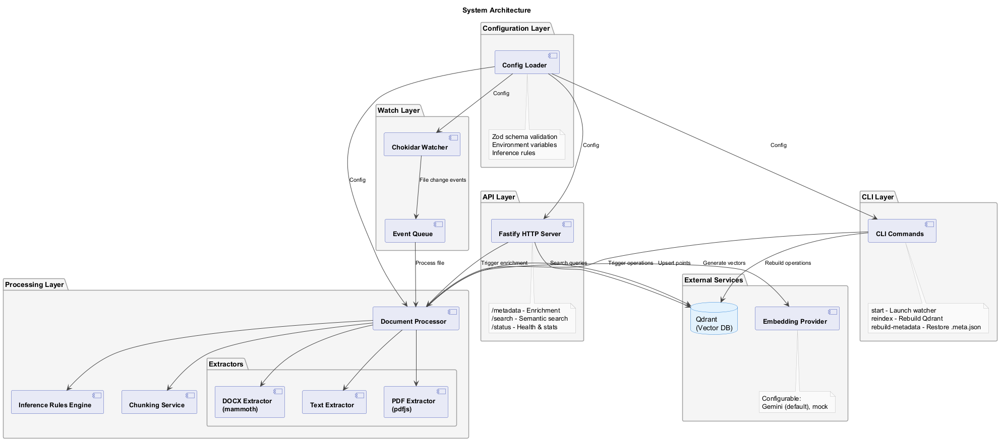
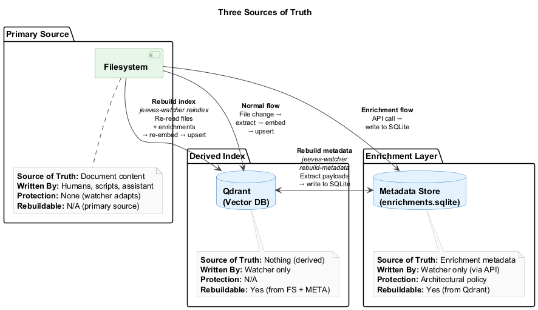
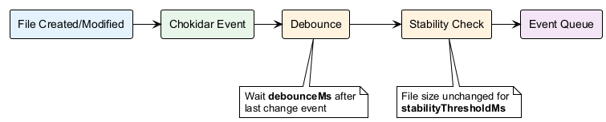
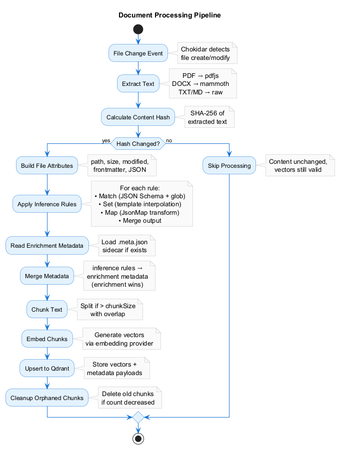
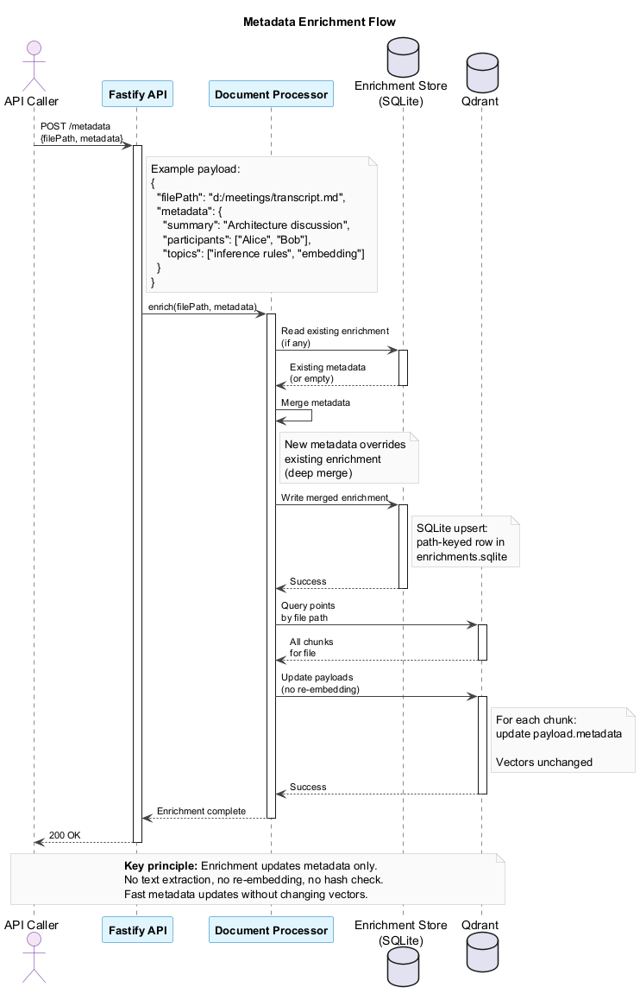
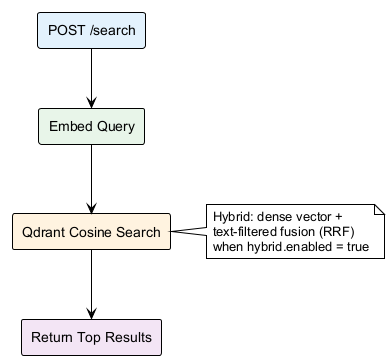
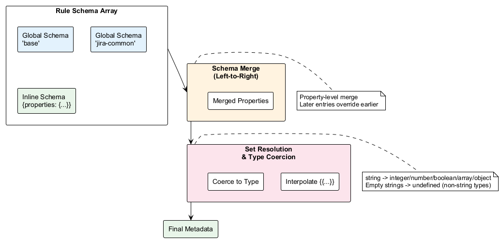
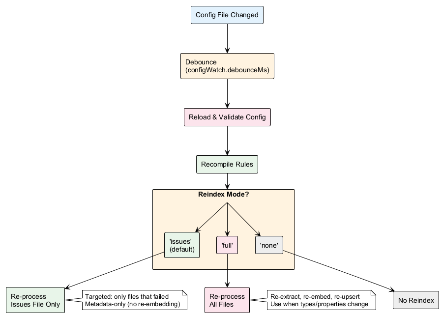

# Architecture

High-level architectural overview of `jeeves-watcher` for contributors and advanced users.

## Design Principles

1. **Files are just files** — Processes write to the filesystem normally. The watcher discovers changes passively.
2. **Config-driven, no domain logic** — The watcher doesn't know what an "email" or "meeting" is. Domain semantics live in config (inference rules).
3. **Embedding is swappable** — Embedding providers are selected by `embedding.provider`; adding a provider is a small, self-contained code change (see [Add a New Embedding Provider](#add-a-new-embedding-provider)).
4. **Metadata enrichment is optional** — The watcher works without it, but callers can enrich documents for better search quality.
5. **Three sources of truth** — Filesystem owns content, the enrichment store owns enrichment, Qdrant is a derived index (fully rebuildable).

---

## System Architecture



The watcher consists of several layered components:

- **Configuration Layer** — Zod-validated config with environment variable substitution
- **Watch Layer** — Chokidar filesystem watcher feeding the file event queue; source-document notifications feed a separate notify queue
- **Processing Layer** — Document processor: resolvers (file and source), extractors, inference rules engine, and one shared chunk/embed/upsert pipeline
- **State** — Enrichment store, issues file and values index under `stateDir` (default `.jeeves-metadata`)
- **External Services** — Configurable embedding provider (behind one shared rate limiter) + Qdrant vector store
- **API Layer** — Fastify HTTP server for search, enrichment, reindex, source notifications and administration
- **CLI Layer** — Command-line interface for operations

---

## Three Sources of Truth



The system maintains three distinct stores:

- **Filesystem** (watched directories) — Primary source of document content
- **Enrichment store** (`<stateDir>/enrichments.sqlite`, `node:sqlite`) — Enrichment metadata added via API
- **Qdrant** (vector database) — Derived index, fully rebuildable

### Rebuild Flows

**Qdrant lost → Rebuild from filesystem + enrichment store:**

```bash
jeeves-watcher reindex --scope full
```

Re-extracts every watched file, merges its enrichment from the enrichment store, re-embeds the content and upserts to Qdrant. (The CLI's default scope is `rules`, which only re-applies rules to points that already exist.)

**Enrichment store lost → Rebuild from Qdrant:**

```bash
jeeves-watcher rebuild-metadata
```

Scrolls Qdrant and, for every file point, writes its payload minus the reserved system fields (identity, chunk, hash, date, line and `matched_rules` fields) to the enrichment store. Rule-derived fields are therefore written too; source documents are not rebuilt.

---

## Data Flow

### 1. File Change Event



**Debounce:** Events for the same path are collapsed until `watch.debounceMs` (default: 300 ms) has passed since the last one (prevents re-embedding during rapid edits).

**Stability Check:** A file event waits until the file's size has been unchanged for `watch.stabilityThresholdMs` (default: 500 ms; prevents embedding partial writes): the shared stability ticker under parcel, chokidar's `awaitWriteFinish` under chokidar.

**Change source and reconciliation (v0.21.0+):** A change source (`@parcel/watcher` by default, or chokidar; `watch.changeSource`) only reports events and root signals; `FileSystemWatcher` owns every decision. It drops events under each root's own `.git`, filters the rest (globs, gitignore) and keeps an inventory of the files that pass, with a directory index so a subtree is read without scanning the whole inventory. `POST /walk` lists that inventory. A reconcile walks a directory and compares it with the inventory: missing files enter one shared stability ticker (at most 2,000 stats per tick) and are added once their size holds for `watch.stabilityThresholdMs`, unless the inventory already has them with the same size and mtime; inventory files that `lstat` confirms gone are unlinked. When the source's own `add` for a file arrives after reconciliation added it, matching stats drop it (the file is enqueued once) and differing ones make it a change. A failed walk, an unreachable root, or an empty root walk against a non-empty inventory emits nothing. Reconciles run for every directory created after the initial scan and every `watch.reconcileIntervalMs` per root (staggered); one runs per root at a time, and triggers during it merge into one rerun per covering directory. Every walk and stability stat shares a limit of 8 filesystem calls in flight, `stop()` silences reconciles still running, and the service runs with `UV_THREADPOOL_SIZE` 16. `GET /status` reports the counts under `health.changeSource`.

**The parcel source (v0.21.0+):** One `@parcel/watcher` subscription per top watch root, with the explicit backend (`windows` or `inotify`; never watchman) and an `ignore` list of the root's `.git` plus `watch.ignored` made root-relative (a pattern whose literal prefix lies above or outside the root is left to the event filter). The subscription handle is the only way it is unsubscribed, and the callback never throws. The initial set is a walk: each root is subscribed first, then walked into the inventory (every matched file enqueued; the processor skips unchanged content), and its batches wait until the walk ends. Each batch goes through one serial FIFO and is classified from the disk (`lstat`, 64 at a time): a present file enters the stability wait; a present directory is a create only when the event is a create or the batch deletes paths under it (attribute changes on directories reconcile nothing); an absent path is a directory delete when the inventory's directory index holds it, a file unlink when the inventory holds it, an unknown Windows 8.3 short name (a reconcile of its parent), or nothing. With `moveDetection.enabled`, a directory delete and a directory create seen within `moveDetection.bufferMs` of each other, in either order, are one move when at least 90% of the deleted subtree's files reappear under the new directory at the same relative path and size: each becomes a move (re-keyed, not re-embedded), unmatched old files are unlinked and unmatched new ones go through the stability wait; an unpaired delete unlinks its files and an unpaired create is reconciled. A subscription error makes the source `lstat` the root: present, it resubscribes with backoff (1 s doubling to 5 min) and the root is reconciled; gone, the root is marked unavailable (nothing is unlinked) until it is back; a failed `inotify_add_watch` leaves the root unwatched but still reconciled. On Linux each periodic reconcile first renews the root's subscription (unsubscribe, then subscribe) to repair the dead watches inotify leaves after a directory rename; an unsubscribe that rejects rebuilds every subscription through a sentinel subscription under `<stateDir>/parcel-sentinel`. Windows renews nothing.

### 2. Document Processing Pipeline



The core processing flow transforms file changes into searchable vectors. The file resolver (steps 1–4) produces a document; the shared pipeline (steps 5–12) indexes it. Source documents use the source resolver and the same pipeline.

1. **Extract Text** — Format-specific extraction (PDF, DOCX, Markdown, etc.)
2. **Build Attributes** — Collect file attributes (path, size, modified, frontmatter, JSON)
3. **Apply Inference Rules** — Match → Schema Merge → Type Coercion → Map → Merge (see [Inference Rules](inference-rules.md))
   - Match rules against file attributes (JSON Schema validation)
   - Merge schema references (global schemas + inline) left-to-right
   - Resolve `set` templates and coerce to declared types
   - Apply JsonMap transformations (if present)
   - Track matched rule names in `matched_rules`
4. **Merge Enrichment** — Read the document's entry from the enrichment store and merge it over the rule metadata (scalars: enrichment wins; arrays: union, deduplicated)
5. **Update Values Index** — Record distinct values per property per matched rule (runs even when the content turns out unchanged)
6. **Empty Check** — Whitespace-only text is skipped (logged at `debug` as `Skipping empty document`)
7. **Ceilings** — Extracted text over `processing.maxTextBytes`, then a split into more than `processing.maxChunksPerFile` chunks, deletes the document's points and records `too_large` (v0.21.0+; a file over `processing.maxFileBytes` was already stopped by a `stat` before step 1)
8. **Content Hash** — SHA-256 of the text to embed (a matching rule's rendered template output, otherwise the extracted text)
9. **Hash Check** — If chunk 0 already carries the same `content_hash`, the file is skipped: nothing is embedded or written
10. **Embed and Upsert, one window at a time** — Up to 100 chunks per embedding request, each window upserted (50 points per request) before the next is embedded, so one window of vectors is in memory (v0.21.0+). The first window writes chunk 0 as a claim: `total_chunks` is the larger of the old and new counts and `content_hash` is absent, so a run failing part-way is never "unchanged" and a delete still reaches every chunk written
11. **Cleanup Orphaned Chunks** — Remove chunks from the new count up to the claimed count if the document shrank
12. **Finalise Chunk 0** — Set its `content_hash` and the new `total_chunks`

### 3. Metadata Enrichment (API)



The enrichment API allows external callers to add metadata without re-embedding:

1. **POST /metadata** with a file `path` (or a source reference `source`) and `metadata`; values that do not match the matching rules' declared property types are rejected with `400 invalid_request`
2. **Store** — The metadata is merged into the document's entry in the enrichment store (top-level keys replace existing ones). For a file, the entry is stored even when the file is not indexed yet, so it applies once it is
3. **Update Qdrant payloads** — If the document is indexed, the stored enrichment is written to the payload of every chunk (reserved system fields are dropped; the stored identity and `matched_rules` are kept)

The payload write is one Qdrant write filtered on the document's `file_path` (or `source`) once that field has a ready keyword index (the `file_path` system index, v0.21.0+), and otherwise one by point ID over the chunks that exist (so a document left as a chunk-0 claim is updated too).

**Key principle:** Enrichment updates metadata only. No text extraction, no re-embedding, no hash check. Fast metadata updates without changing vectors.

### 4. Search Flow



**Chunk deduplication:** Search returns individual chunks. Callers group by `file_path` (or `source`) to get unique documents.

### 5. Facet Counts

`POST /search/facets/counts` (v0.21.0+) answers from Qdrant on every request; nothing is cached or aggregated in the service.

1. **Scope:** the caller's filter, the rule scope (`matched_rules` or `source_rule` any of the named rules) and `chunk_index = 0`, each nested under one `must`, so every document counts once and a caller's top-level `should` keeps its meaning.
2. **Mode per field:** the `uiHint` every in-scope rule declaring the field agrees on (`number`, `date`, `range` give a range), else the payload index type (`keyword`, `bool`, `integer` counted; `float`, `datetime` ranged). The index types come from the collection's payload schema on each request.
3. **Reads:** an approximate Qdrant facet call per counted field (Qdrant's default mode; D194: exact counts failed the latency gate below); two one-point scrolls ordered by the field (ascending, descending) per range.
4. **Bounds:** at most 4 fields at a time within a 10 s budget; each call gets the seconds left as Qdrant's `timeout`. Past the budget nothing starts, in-flight results are discarded and the route answers `503` naming the fields not counted. It also answers `503` until the `chunk_index` system index (and, for a `rules` request, `matched_rules`) is ready.

The design was gated (D104) on Qdrant's facet latency over a production-sized copy: p95 at most 200 ms for 4 fields under a tenant filter (with or without `rules`) and 500 ms for 20 fields unfiltered. `npm run facet:gate -w packages/service -- --source-collection <name>` re-runs that measurement on a throwaway Qdrant (the source collection is only read), after first comparing approximate with exact counts for every workload field (D194: it fails when a top-10 value is missing or off by more than 5%).

---

## Chunking Strategy

Documents exceeding `embedding.chunkSize` (default: 1000 characters) are split into chunks.

**Splitters:**

- **Markdown files** (`.md`, `.markdown`) — `MarkdownTextSplitter` (splits on heading boundaries, preserves structure)
- **All other files** — `RecursiveCharacterTextSplitter` (splits on `\n\n`, then `\n`, then spaces, then characters)

Both splitters use:

- `chunkSize` — max characters per chunk
- `chunkOverlap` — overlap between consecutive chunks (default: 200; helps preserve context at boundaries)

**Chunk Points:**

Each chunk becomes a separate Qdrant point with:

- **Unique ID:** `pointId(filePath, chunkIndex)` (deterministic UUID)
- **Shared payload:** `file_path`, `matched_rules`, rule and enrichment metadata, `content_hash`, `created_at`, `modified_at` (same across all chunks)
- **Chunk-specific:** `chunk_index`, `total_chunks`, `chunk_text`, `line_start`, `line_end`

**Example:**

File with 3 chunks → 3 Qdrant points:

| Point ID | `chunk_index` | `total_chunks` | `chunk_text`      |
| -------- | ------------- | -------------- | ----------------- |
| `uuid-0` | `0`           | `3`            | "First chunk..."  |
| `uuid-1` | `1`           | `3`            | "Second chunk..." |
| `uuid-2` | `2`           | `3`            | "Third chunk..."  |

---

## v0.5.0 Processing Details

### Schema Merge Flow

The v0.5.0 inference rules system uses declarative JSON Schemas with type coercion. When a rule matches a file, the watcher merges schema references and applies type coercion:



**Key steps:**

1. **Resolve named references** from global `schemas` collection
2. **Merge properties** left-to-right (later entries override earlier ones)
3. **Validate completeness** — every property must have a `type`
4. **Resolve `set` templates** — interpolate `{{...}}` Handlebars expressions against file attributes
5. **Coerce values** — convert strings to declared types (integer, number, boolean, array, object)
6. **Omit failures** — properties that fail coercion are excluded from payload

### Config Watch Reindex Flow

When the config file changes, the watcher triggers a reindex whose scope is set by `configWatch.reindex`:



**Scopes:**

- **`issues`** (default) — Re-process only the files and source references listed in the issues file (cheap, targeted)
- **`rules`** — Re-apply the rules to indexed files without re-embedding
- **`full`** — Re-process all watched files and indexed source documents (expensive, comprehensive)

To turn automatic reloads off, set `configWatch.enabled` to `false` (then use `POST /reindex` manually).

---

## Content Hashing

Every processed document gets a content hash (`sha256` of the text to embed) stored in the Qdrant payload.

**Whenever a file is processed** (initial scan, create, modify, `issues`/`path`/`full` reindex):

1. Extract text and apply rules
2. Compute hash
3. Read the existing chunk-0 point from Qdrant
4. If `content_hash` matches → **skip** (no embedding API call, no write)
5. If the hash differs or the point is missing → re-embed and upsert

**Benefits:**

- Saves embedding API calls when the embedded text is unchanged (e.g. a file touched or rewritten with the same content)
- Prevents unnecessary Qdrant writes
- Speeds up reindex (only changed files are re-embedded)

**Note:** A skipped file is not rewritten at all, so an edit that leaves the embedded text unchanged (such as a Markdown frontmatter-only edit) does not refresh rule metadata on its points. Run a `rules` reindex to re-apply rules without re-embedding.

---

## Point ID Generation

Qdrant point IDs are **deterministic UUIDs** derived from the document's identity (see `src/pointId/index.ts`):

```typescript
import { v5 as uuidV5 } from 'uuid';

const NAMESPACE = '6a6f686e-6761-4c74-ad6a-656576657321'; // fixed

// Files: the path is normalised, so file IDs are case-insensitive.
function pointId(filePath: string, chunkIndex: number): string {
  return uuidV5(`${normalizePath(filePath)}#${chunkIndex}`, NAMESPACE);
}

// Source documents (v0.20.0+): the exact <name>://<id> reference, not normalised.
function sourcePointId(reference: string, chunkIndex: number): string {
  return uuidV5(`${reference}#${chunkIndex}`, NAMESPACE);
}
```

**Why deterministic:**

- Same file always produces the same ID
- No need to store ID anywhere — it's computable from the path
- A move gets new IDs: the old points are re-written under the new path's IDs (vectors reused, no re-embed) and then deleted

**Trade-off:** Renaming/moving files changes their identity in the index. Acceptable — the watcher handles it transparently (with `watch.moveDetection`, an unlink followed by an add of the same content is treated as a move).

---

## Event Processing

### File Event Queue

Filesystem events go through one debounced, concurrent queue.

**Debounce:** Events for one path (and priority) are collapsed: only the last event within `watch.debounceMs` (default: 300 ms) is processed.

**Concurrency:** Up to `embedding.concurrency` (default: 5) documents are processed at once; normal-priority events run before low-priority ones. Embedding API requests from every path (watch, source-document notifications, reindex, search) draw from one shared rate limiter (`embedding.rateLimitPerMinute`, counted in requests since v0.20.0).

**Failures:** A failing document is logged and recorded in the issues file; it does not stop the queue.

**Document locks (v0.21.0+):** Every process, delete, move, ceiling deletion and metadata change (`POST /metadata`, rule re-application) of one document runs under an in-process FIFO lock keyed by the normalised file path (the point-ID normalisation) or the source reference. Different documents still run concurrently; two runs of one document never interleave. A move takes both paths' locks in sorted order. Background work waits as long as it takes; `POST /metadata`, `POST /rules/reapply` and `POST /documents/delete` wait at most 10 s per document, then answer `503 not_available` with `Retry-After: 10`. A lock held over 5 minutes is logged as a warning.

### Source Notify Queue

Source-document notifications (v0.20.0+) go through a separate in-memory queue keyed by reference, with the same `embedding.concurrency`. Pending notifications for one reference merge; a notification for a reference that is already running marks it for exactly one re-run.

### Resolvers

Both queues end in the document processor. A **file resolver** stats and extracts the file and applies every matching rule; a **source resolver** retrieves the `<name>://<id>` reference through its callback and applies only the designated rule. Each produces a resolved document for the same chunk/embed/upsert pipeline. Source rules get no file reader: a map's `fetchSiblings` returns nothing for a source document.

### Startup Behavior

On service start:

1. Load and validate the config; reserved-field warnings are printed to the console
2. Create the Qdrant collection if missing and ensure its payload indexes
3. Open the enrichment store, issues file and values index under `stateDir`
4. Start the API server, then the filesystem watcher and the source notify queue
5. Initial scan: every file matching `watch.paths` (and not ignored or gitignored) is queued as a create event
6. Each queued file runs through the pipeline: unchanged files are skipped by content hash, new and modified files are embedded

Points of files deleted while the service was down are **not** removed at startup; run a `prune` reindex (`jeeves-watcher reindex --scope prune`) to delete them.

### Config Change Handling

When `configWatch.enabled` is `true` (the default) and the service was started with a config path, the watcher monitors its own config file.

**On config change:**

1. Debounce for `configWatch.debounceMs` (default: 1000 ms)
2. Reload and validate the config; reserved-field warnings are logged as warnings
3. Recompile inference rules and rebuild the template engine
4. Rebuild the filesystem watcher if the `watch` config changed
5. Run a reindex with scope `configWatch.reindex` (default: `issues`)

A reload that fails is logged (`Failed to reload config`) and the previous config stays in effect. `api.apiKey`, `sources` and `vectorStore.payloadIndexes` are read at startup only.

---

## Enrichment Store Design

### Storage

Enrichment lives in a SQLite database at `<stateDir>/enrichments.sqlite`, opened with Node's built-in `node:sqlite` (WAL journal, 5 s busy timeout). One table holds one row per document:

| Column       | Content                                          |
| ------------ | ------------------------------------------------ |
| `path`       | Document key (primary key)                       |
| `metadata`   | Enrichment metadata as JSON (no content/vectors) |
| `created_at` | ISO timestamp of the first write                 |
| `updated_at` | ISO timestamp of the last write                  |

**Keys:** File paths are normalised (lowercase, forward slashes), so lookups are case-insensitive; source references (`<name>://<id>`) are stored verbatim.

**Merge on write:** A new write merges into the existing entry; top-level keys of the new metadata replace existing ones.

### Write Policy

The enrichment store is **watcher-owned**. Only the watcher process writes to it: `POST /metadata`, `POST /rebuild-metadata`, file moves (the entry follows the file) and file deletes (the entry is removed).

**Enforcement:** Architectural policy (single writer; no filesystem permissions).

---

## Inference Rules Engine

Rules are **JSON Schema `match` + `schema` arrays**, evaluated in order against file attributes.

**Attributes:**

```json
{
  "file": {
    "path": "d:/meetings/2026-02-20/transcript.md",
    "directory": "d:/meetings/2026-02-20",
    "filename": "transcript.md",
    "extension": ".md",
    "sizeBytes": 4523,
    "modified": "2026-02-20T08:15:00.000Z"
  },
  "frontmatter": { "title": "Meeting Notes", "author": "jeeves" },
  "json": { "participants": ["Alice", "Bob"] }
}
```

**Rule example (v2):**

```json
{
  "name": "meetings-classifier",
  "description": "Classify meeting transcripts and notes",
  "match": {
    "properties": {
      "file": {
        "properties": {
          "path": { "type": "string", "glob": "d:/meetings/**" }
        }
      }
    }
  },
  "schema": [
    "base",
    {
      "properties": {
        "domain": { "type": "string", "set": "meetings" },
        "title": { "type": "string", "set": "{{frontmatter.title}}" }
      }
    }
  ],
  "map": "extractProject"
}
```

**Processing order for each matching rule:**

1. **`match`** — JSON Schema validation against file attributes
2. **Schema merge** — Resolve named schemas + inline objects, merge left-to-right
3. **`set` resolution** — Handlebars template interpolation (`{{...}}`) resolves against attributes, with type coercion
4. **`map`** — JsonMap transformation (inline or named reference)
5. **Merge** — `map` output overrides `set` output on field conflict

**Custom `glob` keyword:** Picomatch glob matching registered as an ajv custom keyword. Everything else is standard JSON Schema (with the standard `ajv-formats` formats).

**JsonMap transformations (`map`):**

Rules can reference named maps from the top-level `maps` config, or include inline JsonMap definitions. The watcher provides lib functions for path manipulation and lookups: `split`, `slice`, `join`, `toLowerCase`, `replace`, `get`, `lookupJson`, `mapLookup`, `fetchSiblings`; custom functions can be added via `mapHelpers`.

See [Inference Rules Guide](./inference-rules.md) for full details.

---

## Text Extraction

### Extractors by File Type

| Extension | Strategy |
| --- | --- |
| `.md`, `.markdown` | Parse YAML frontmatter (exposed as `frontmatter` attributes), return the body text |
| `.txt`, `.text` | Return as-is (BOM stripped) |
| `.json` | Return the first non-empty string among `content`, `body`, `text`, `snippet`, `subject`, `description`, `summary`, `transcript`; otherwise the serialized JSON. A JSON object is also exposed as `json` attributes |
| `.pdf` | Extract text via the `unpdf` library (pages joined) |
| `.docx` | Extract raw text via the `mammoth` library |
| `.html`, `.htm` | Drop `script`/`style`, take the body text via the `cheerio` library |

**Any other extension** is read as plain text. Use `watch.paths` globs (or `watch.ignored`) to keep binary files such as `.png` out of the index. A file whose extracted text is empty or whitespace-only is skipped.

---

## Error Handling & Retry

Transient failures are retried; anything that still fails is recorded as an issue:

| Failure | Retry Policy |
| --- | --- |
| Embedding provider 429 (rate limit) | Every caller pauses on the shared limiter. A `Retry-After` up to `maxBackoffMs` (default 60 s) is honoured; a longer one fails fast. Without `Retry-After`: backoff from 1 s, doubling, capped at `maxBackoffMs`. Up to 5 provider calls per embed (3 for a search query) |
| Embedding provider network error or other non-2xx | 5 attempts, exponential backoff from 500 ms capped at 10 s (+ up to 20% jitter); each retry draws from the shared limiter |
| Qdrant write (upsert, delete, set-payload, delete-payload) | 5 attempts, same backoff, each retry on a fresh Qdrant client |
| Text extraction error | No retry (logged and recorded as an `extraction_error` issue) |

**Embedding health (v0.21.0+):** A tracker wraps the shared rate-limited provider. At least 3 failed calls with 60 s without a success turn it `failing` (`GET /status` reports `degraded`, an error is logged, and `embedding.alertUrl` gets `embedding_failed`); the first success turns it `ok` again (`embedding_recovered`). A stored provider back-off is capped at 5 minutes, then expires; the first call after it probes the provider. Alerts and the reindex callback share one delivery helper: 3 attempts, 1 s then 2 s apart, 10 s timeout each, never thrown. See [Embedding Health](./configuration.md#embedding-health).

**Issues file:** Documents that fail are recorded in the issues file (persisted to `{stateDir}/issues.json`) with a canonical issue code (`embedding_error`, `upsert_error`, `extraction_error`, ...). Surfaced via `GET /issues`; re-processed by an `issues` reindex (the default on config reload).

---

## Graceful Shutdown

On SIGTERM/SIGINT (v0.20.0+ order):

1. Stop the config watcher
2. Close the API server, so no new request (notification, reindex, ...) is accepted
3. Stop the remaining producers: VCS, then the filesystem watcher
4. Drain and stop the file event queue, then drain and stop the source notify queue (each drain and each stop bounded by `shutdownTimeoutMs`, default 10 s); stopping drops work the drain did not reach and waits for in-flight runs
5. Flush the values index
6. Close the enrichment store, unless a queue step timed out (runs may still be in flight; the store is then left open and a warning is logged)
7. Exit

Partially processed files are safe — on the next start the initial scan re-processes every file, and content hashing skips the ones already indexed.

---

## Collection Bootstrap

On startup, if the Qdrant collection doesn't exist, the watcher creates it, then creates any missing payload indexes (configured `vectorStore.payloadIndexes` plus the `source`/`source_rule` indexes), and starts the background build of the system indexes (`chunk_index`, `file_path` and `matched_rules`, v0.21.0+; startup does not wait, a start that finds them built creates nothing, and `GET /status` reports `health.collection.systemIndexes`):

```javascript
await qdrant.createCollection(collectionName, {
  vectors: {
    size: dimensions, // embedding.dimensions (Gemini default: 3072)
    distance: 'Cosine',
  },
});
```

**Existing collections:** If the collection already exists, it is used as-is — dimensions and distance metric are not validated against config on startup.

**Dimension mismatch warning:** If you manually create the collection with different dimensions (e.g., 768 instead of 3072), the service will start but embedding upserts will fail with a dimension mismatch error.

**Recovery:** Delete the collection manually (or rename `collectionName` in config), then restart. The watcher will recreate the collection with correct dimensions.

---

## Logging

Structured JSON logging via [pino](https://github.com/pinojs/pino), at `logging.level` (default `info`):

| Level | Events (log message) |
| --- | --- |
| `info` | `File processed successfully`, `File deleted from index`, `File moved in index`, `Metadata updated`, `Config reloaded`, `Initial scan complete`, `Reindex (<scope>) completed`, `jeeves-watcher started` / `stopped` |
| `warn` | `Embedding call failed; will retry`, `Qdrant <operation> failed; will retry`, shutdown step timeouts, reserved-field warnings on reload |
| `error` | `Failed to process file` (after retries; issue recorded), `Failed to reload config`, `Reindex failed`, `Watcher error` |
| `debug` | `Content unchanged, skipping`, `Skipping empty document`, `File added` / `File changed` / `File removed`, `Skipping gitignored file` |

**Log format:** JSON lines on stdout, or to `logging.file` when set (parseable by standard log aggregators). A log file rotates by size and schedule through `pino-roll` (`logging.rotation`, default 10 MiB, daily, 14 files kept), written on the main thread and opened before the first line. A refused or failed start is logged as `fatal`, flushed synchronously, and repeated on stderr.

---

## Technology Choices

| Component | Library | Rationale |
| --- | --- | --- |
| Filesystem watcher | `@parcel/watcher` (default), `chokidar` | One native subscription per root (`windows` / `inotify` backends); chokidar is the manual switch and the polling source (globs are matched with `picomatch`) |
| HTTP framework | `fastify` | Lightweight, fast |
| Request validation | `zod` | Shared request/response schemas in the core package |
| Text splitting | `@langchain/textsplitters` | Markdown-aware + recursive splitting |
| JSON Schema validation | `ajv` | Fast, extensible (custom `glob` keyword) |
| Embedding client | Direct HTTPS (`node:https`, Gemini REST API) | No SDK bloat |
| Qdrant client | `@qdrant/js-client-rest` | Official client, typed |
| Enrichment store | `node:sqlite` | Built into Node.js, no native build |
| Logging | `pino`, `pino-roll` | Structured JSON, low overhead; size- and schedule-based file rotation |

---

## Extending the Watcher

### Add a New Extractor

Extractors are registered in code, not in config. Implement an extractor and add it to `extractorRegistry` in `src/extractors/index.ts`:

```typescript
async function extractYaml(filePath: string): Promise<ExtractedText> {
  const content = await readFile(filePath, 'utf8');
  const parsed = yamlLoad(content) as Record<string, unknown>;
  return {
    text: JSON.stringify(parsed, null, 2),
    json: parsed,
  };
}

const extractorRegistry = new Map<string, Extractor>([
  // ...existing entries
  ['.yaml', extractYaml],
]);
```

### Add a New Embedding Provider

1. Implement a provider factory (see `src/embedding/types.ts`):

```typescript
const createMyProvider: ProviderFactory = (config, logger) => ({
  dimensions: config.dimensions ?? 1024,
  async embed(texts: string[]): Promise<number[][]> {
    // Call your provider's API (one request per call)
  },
});
```

2. Register it in `embeddingProviderRegistry` in `src/embedding/index.ts`:

```typescript
const embeddingProviderRegistry = new Map<string, ProviderFactory>([
  ['mock', createMockFromConfig],
  ['gemini', createGeminiProvider],
  ['my-provider', createMyProvider],
]);
```

3. Use in config:

```json
{
  "embedding": {
    "provider": "my-provider",
    "model": "my-model",
    "apiKey": "${MY_API_KEY}"
  }
}
```

---

## Version Control Subsystem

The VCS subsystem runs alongside the embedding pipeline as an independent data flow. Both systems share watch paths but maintain separate state.

### VCS Data Flow

1. **File change event** → routed to both the embedding pipeline and VCS coordinator
2. **VCS coordinator** → maps the file to the correct watch root's `VcsManager`
3. **VcsManager** → adds file to pending set, starts the throttle timer (not reset by later changes)
4. **Throttle expires or batch full** → under the root lock, the batch is staged (one tracked check: `add -u` for tracked files, `check-ignore` then `add` for new ones, `rm --cached` for deletions; over-cap tracked files untracked in their own commit), a commit message generated, and the batch committed
5. **If remote configured** → pushes to remote (non-blocking)
6. **Squash scheduler** (cron) → periodically squashes old commits per retention rules

### Key Design Decisions

- **D1:** VCS is opt-in (`vcs.enabled: false` by default)
- **D2:** One git repo per watch root — isolated histories
- **D3:** VCS and watcher indexing are independent — git can track files the watcher cannot embed and vice versa
- **D4:** Child repos tracked uniformly; child `.git/` directories excluded
- **D5:** Debounced batch commits prevent per-file commit noise
- **D6:** AI commit messages via the Anthropic API (key from `vcs.commitMessage.apiKey`, else from the local OpenClaw config); template message fallback
- **D7:** Squash retention with `maxAgeDays` / `maxVersions` (tighter wins)
- **D8:** Forward-only reversion — `git show` + write, HEAD never moves backward
- **D9:** Optional remote push per root with access token auth
- **D12:** Per-root config overrides via `watch.paths` object entries
- **D13:** Force push after squash — acceptable because remote is a backup mirror
- **D14:** Git is a soft dependency — graceful degradation if not installed
- **D15:** `stateDir` must not overlap watch paths — validated at startup when VCS is enabled

### Concurrency

Each root has an in-process FIFO lock (`RootGitLock`) held by batch commits (with their push), squash, untracking and temp-file sweeps, so the watcher's own git work on a root never overlaps. Squash commits the pending batch inside its hold, then rewrites history with plumbing (`commit-tree`) and moves the branch with a compare-and-swap `update-ref`, so a foreign commit made meanwhile makes it skip, not lose data. The lock cannot exclude other processes: `index.lock` contention with external git is retried (4 attempts, exponential backoff), and every git call runs the real binary with a timeout, after which the killed child's own `index.lock` and temp files are cleaned up. Staging timeouts are bisected within a budget of three times the first timeout.

See the [Version Control (VCS) Guide](./version-control.md) for full operational details.

---

## Next Steps

- [Configuration Reference](./configuration.md) — All config options
- [Inference Rules Guide](./inference-rules.md) — Rules engine deep dive
- [API Reference](./api-reference.md) — HTTP endpoints
- [Deployment Guide](./deployment.md) — Production setup
